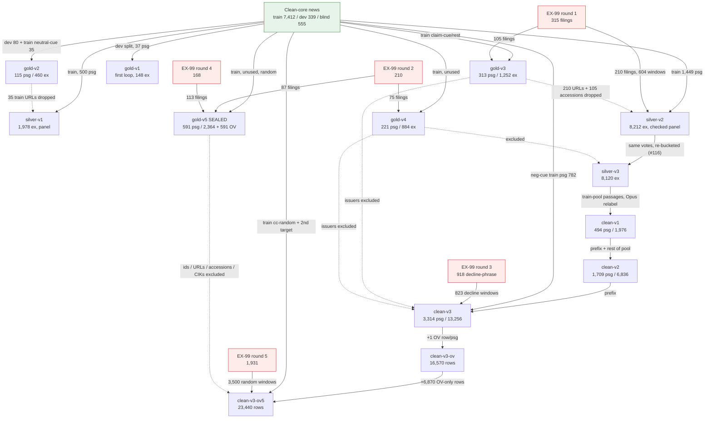

# Dataset lineage in the quick loop

Researched 2026-10-21 for issue #155. This note covers where each dataset in `.scratch/quick-loop/` came from, how the datasets differ, and how they are linked by exclusions. It also lists the facts that #156 ("Decide which datasets the published results report on") needs. It does not make that decision.

**Sources.** The primary sources are:

- issues #46 and #98–#154, including their resolution comments;
- the JSON files themselves, inspected with Python for top-level keys, row counts, label mix and source mix only;
- `.scratch/ex99/filings.jsonl` and `fetch.py`;
- `CONTEXT.md`, `research/*rights*.md`, `research/stage-1-widened-source-plan.md` and `manifests/`.

Counts marked **(file)** were recomputed from the files on 2026-10-21. Counts marked **(#N)** are quoted from that issue.

**Containment.** This note quotes no passage text, accession numbers or company names, only counts and field names (#112). gold-v5 was read for metadata, counts and its ceiling files only. No model output was scored against it.

---

## 1. Vocabulary in one screen

| Term | Meaning here | Where it is defined |
|---|---|---|
| Target–aspect example | A (passage, company, aspect) triple. Each passage gives 4 aspect examples: FP financial performance, DC demand and commercial traction, OS operations, supply and capacity, OE outlook and expectations. | `CONTEXT.md` |
| 4-class labels | `+` positive, `-` negative, `=` neutral, `.` insufficient evidence. `x` means the target is not a company, and the row is excluded. | `CONTEXT.md`, `run.py` rules, `clean-rules.md` |
| Signal task | 3-class: positive, negative, **No signal**. No signal = `=` and `.` merged mechanically. Used from map #120 on. | `CONTEXT.md` (#120) |
| OV | **Overall company sentiment**: a fifth input string, `overall company sentiment`, labelled `+ - .`. It is the net implication of the passage for the company, from all evidence, including what the aspects exclude (share price, legal, governance and so on). Added on map #133 (#146). | `CONTEXT.md` (#146) |
| Clean core | The Stage 1 open-rights news pool `stage-1-clean-core-company-target-v1`. It pools three components: **MOT VOA** (Multilingual Open Text v1.11 `eng_voanews`), a **saved VOA staff-news crawl**, and the **filtered Common Pile News** (8 CC BY / CC BY-SA publishers). Exact-text and article duplicates are removed, and wire-agency copy is rejected. Its splits are 7,412 training / 339 development / 555 blind candidate passages (8,306 total). | `manifests/stage-1.clean-core-source-v1.json`, `research/stage-1-widened-source-plan.md` (#82) |
| EX-99 | Exhibit 99 to an SEC Form 8-K: the press release attached to the filing. Here it is always **Item 2.02 (Results of Operations) EX-99.1 earnings releases**, fetched from EDGAR full-text search. The text is issuer-copyrighted, so it is **restricted auxiliary material** under the Two-lane data portfolio (#105, #112). | #105, #112, #113 |
| Panel (agreement panel) | Free/paid-twin LLM voters: Nemotron 3 Super + Qwen 3.8 27B on OpenRouter, using the aspect-rules prompt. | #100, #101, #110 |
| Opus labels | Claude Opus 5.5, as the agent itself (gold-v1 to v4) or as fresh blind subagents (#123 on). | file `_labeler` fields |

---

## 2. The sources

### 2.1 Clean-core news (open-rights lane)

- **What it is.** It pools MOT VOA (6,346 train / 168 dev / 0 blind), the saved VOA crawl (22 / 41 / 336) and Common Pile News (1,044 / 130 / 219) (#82, `research/stage-1-widened-source-plan.md`). The matcher is `any-named-company-claim-v6`. About 22% of the targets it names are not companies (#107), and on random news draws that rose to about 32–34% (#131, #139, #149).
- **Rights** (`research/voa-news-source-rights.md`, `research/filtered-common-pile-source-rights.md`, `manifests/mot-voa.filtered-source-v1.json`):
  - VOA: "material produced exclusively by the Voice of America is in the public domain." AFP, AP and Reuters copy is excluded by byline and credit regexes; the MOT build reuses the VOA build's regexes. Stated uncertainty: VOA does not prove each author's federal-employee status.
  - The MOT collection is CC BY 4.0 over public-domain VOA text (`public-domain-voa-produced-and-CC-BY-4.0-collection`).
  - Common Pile is restricted to 8 publishers with an exact first-party CC licence. 360info, Factly and Freedom of the Press Foundation are CC BY 4.0; Alt News, Balkan Diskurs and Global Voices are CC BY 3.0; Oxpeckers and The Public Record are CC BY-SA 4.0, so ShareAlike applies to adaptations. Attribution needs the author, title, source link, licence link and a change notice. Quotes, embeds and credited third-party material can carry other rights.
- **Which split the quick loop used.** Every news passage in silver, clean and gold-v3/v4/v5 comes from the **training split**. The **development split** was read only by gold-v1 (37 passages) and gold-v2's random stratum (103 drawn, 80 kept), so about 199 of 339 remain unread (#99, #136). The **blind split (555) was never read** (#99, #109, #136, #148).
- **CC-NEWS (IOL)** is the other Stage 1 source. It is restricted auxiliary, blind-only, manifest-only, and its terms allow non-commercial use only (`research/cc-news-publisher-rights-audit-v2.md`). **No quick-loop dataset uses it** (#105, #129 rejected it).

### 2.2 EX-99 earnings releases (restricted auxiliary lane)

The rights finding (#105): issuer text is not a US Government work (17 U.S.C. §101). The SEC "public information" policy covers sec.gov content, not filer text. Exhibits carry issuer © notices. PR Newswire's terms ban scraping and AI training. The containment terms (#112) are:

1. gitignored storage (`.scratch/ex99/`, `.scratch/quick-loop/`);
2. private Kaggle only;
3. no passage text in issues, PRs, artifacts or notes;
4. any checkpoint trained on it is never published and is labelled *not a clean-core checkpoint*;
5. it never enters a sealed manifest, run or blind split.

All rounds use EDGAR full-text search with form 8-K, keeping only hits whose items include `2.02` and whose document is `EX-99.1`. Requests are spaced 0.15 s apart (≤7 requests/s) under a declared User-Agent. Prior-round CIKs are skipped, so **every filing is from a new issuer: 3,542 filings = 3,542 CIKs (file)**.

| Round | Ticket | Query and window | Filings (file) | Date range (file) | Went into |
|---|---|---|---|---|---|
| 1 | #113 | `"financial results"`, 15/month, 2025-01–2026-09 | 315 | 2025-01-13 → 2026-09-28 | gold-v3 105; silver-v2/v3 and clean 208 |
| 2 | #117 | same query, `PER_MONTH=25`, new issuers | 210 | 2025-01-07 → 2026-09-30 | gold-v4 75; gold-v5 87; 48 unused |
| 3 | #131 | **decline phrases** ("revenue decreased/declined", "net sales decreased", "sales declined", "net loss increased"), `FROM_YEAR=2024` | 918 | 2024-01-04 → 2026-09-29 | clean-v3 823 decline windows (Signal-enriched, so excluded from gold-v5) |
| 4 | #139 | `"financial results"`, `PER_MONTH=8`, natural, new issuers | 168 | 2025-01-10 → 2026-09-30 | gold-v5 113 |
| 5 | #149 | `"financial results"`, `PER_MONTH=25`, `FROM_YEAR=2019`, natural | 1,931 | 2019-01-07 → 2026-09-29 | clean-v3-ov5: 3,500 random windows from 1,840 filings |

**Passage types** cut from a filing:

- **lead**: about 150 words from the dateline sentence;
- **neutral window**: about 150 words from the first non-boilerplate neutral-cue sentence;
- **window**: up to 2 non-boilerplate windows per filing (silver-v2);
- **decline window**: from 1 sentence before the first decline sentence;
- **random window**: up to 2 random non-lead windows, with table-heavy windows filtered out.

The issuer is always the target.

---

## 3. Lineage diagram



Plain-text version of the backbone:

```
clean-core train ─┬─ silver-v1 (panel) ─────────────────────────────── train v1
                  ├─ silver-v2 (checked panel) ── silver-v3 (re-bucketed) ─ train v2/v3
                  │                                   └─ passages ─ clean-v1 ⊂ clean-v2 ⊂ clean-v3 ⊂ (+OV) clean-v3-ov ⊂ (+OV rows) clean-v3-ov5
EX-99 R1 ─────────┘                       EX-99 R3 (enriched) ──────────────┘           EX-99 R5 + new news ──┘
gold-v1 (dev split) → gold-v2 (dev+train) → gold-v3 (R1) → gold-v4 (R2) → gold-v5 (R2+R4, sealed)
```

---

## 4. Dataset by dataset

### 4.1 Gold and evaluation sets

**gold-v1** (`gold-labels.json` over `dev-ordered.json`). This is the pre-map first loop of 2026-10-01: 37 hand-picked clean-core **development-split** passages giving 148 examples. It was labelled by Opus in a single pass with no model outputs seen. Mix (file): 120 `.`, 17 `+`, 11 `-`, 0 `=`. It was used to test the vote prompt and the aspect rules, with many looks (#98). It is not used after map #98.

**gold-v2** (`gold-v2.json`; `sample.py`; #99, map #98).

- **Draw.** Seed 20261001: 143 drawn and 28 excluded as non-companies (19.6%), leaving 115 passages and 460 examples. That is 80 **random** passages from the clean-core **development split** plus 35 **neutral-cue** passages from the **training split**; the dev and blind splits held no neutral claims.
- **Labeller and mix.** Opus (the agent), a single pass, blind to models. Mix: 416 `.` / 23 `-` / 14 `+` / 7 `=`.
- **Role.**
  - First, it was the decider for map #98: free-model scores (#100), panel choice (#101) and the v1 specialist call (#102).
  - Then it was the tuning set for the two-verifier precision check (#106) and the target for a second-judge consistency test (#104: 113/120 agree).
  - Finally, it became a **secondary report only**. 112 of its rows survive the company check (`gold-v3.json → gold_v2_secondary_keys`).
- **Links.** Its 35 training-split URLs are `drop_from_silver_training`. Check (file): 0 of them are in silver-v1's draw.

**gold-v3** (`gold-v3.json`; `gold3.py`; #109, map #103).

- **Draw.** Seed 20261005, 315 drawn, 313 kept, 1,252 examples. Each batch held 20 cc-claim, 10 cc-rest, 10 ex-lead and 5 ex-neutral passages, drawn until the floors of 30 `+` / 30 `-` / 15 `=` were met (the cap was 400). News came from unused clean-core training passages (pool 6,873 in the file metadata; #109's text says 7,412, which is the whole training split) after a paid Super company check. EX-99 came from round 1.
- **Labeller.** Opus (the agent), blind, batch by batch, plus the new operations rule (#109).
- **Mix.** 4-class: 1,069 `.` / 103 `+` / 65 `-` / 15 `=`; 14 of the 15 neutrals are EX-99. By source: clean-core 208 passages, EX-99 105. Strata (file): cc-claim 139, cc-rest 69, ex-lead 70, ex-neutral 35. OV (added in #147 by a fresh blind five-column relabel; backup `gold-v3.pre-ov.json`): 106 `+` / 103 `-` / 104 `.`.
- **Role.** It was the decider for v2 (#111). It was demoted to **dev** at the charting of map #115, because #114 tuned levers on it. From then on it was the t/threshold set and the source of the **prior-correction target prior**: from #121 the specialist's per-aspect prior shift targets gold-v3's merged prior, and #138 takes the OV target prior from gold-v3's OV column. It is half of the pooled dev in maps #133 and #150.
- **Links.** It drops 210 clean-core URLs and 105 EX-99 accessions from silver. Its issuers are excluded from clean-v3's EX-99 draw and from gold-v5.

**gold-v4** (`gold-v4.json`; `gold4.py`; #117, map #115).

- **Draw.** Seed 20261009, 225 drawn, 221 kept, 884 examples. Same recipe and floors as gold-v3, but the claim-cue stratum was exhausted by silver-v2, so its slots went to cc-rest (user decision). The news pool was 5,216 unused passages with no shared article. EX-99 came from round 2 (new issuers).
- **Labeller.** Opus (the agent), blind, labelled before any v3 output existed.
- **Mix.** 4-class: 733 `.` / 92 `+` / 44 `-` / 15 `=`. Strata (file): cc-claim 56, cc-rest 90, ex-lead 50, ex-neutral 25. OV: 86 / 68 / 67.
- **Extra labellings on gold-v4:**
  - **user blind slice**, 100 items, label-balanced, κ 0.955 against Opus (#122; `relabel-*`);
  - **Opus self-agreement B**, 884 examples, 0.897 [0.863, 0.927] (#135; `selfagree-v4/`);
  - **Opus OV B**, 0.940 [0.905, 0.969] (#147; `ov-gold-v4B/`).
- **Role.** It decided four specialist calls (#119, #124, #127, #132) and was scored post hoc once more (v3 outputs merged to 3 classes, in #120's notes). From map #133 it is **dev** (screens #137 and #142, the seed-1 checks in #140 and #149, and #151–#154).
- **Links.** It drops 150 clean-core URLs and 75 accessions. Its issuers are excluded later.

**gold-v5** (`gold-v5.json`; `gold5.py`; #136 spec, #139 build, map #133, reused by map #150). **This is the sealed test.**

- **Draw.** Seed 20261011, 591 passages / 2,364 aspect examples, plus 591 OV rows.
  - News: 391 random passages (`cc-random`) from 4,076 unused clean-core training passages, at the natural prior with no cues. The labellers' `x` served as the company check, and 165 `x` rows were topped up from spares.
  - EX-99: 200 filings, 193 lead and 7 neutral windows, one per filing. 87 come from round 2 and 113 from round 4 (file). Round 3 was excluded as enriched.
- **Labeller.** **Double-blind fresh Opus subagents.** A is gold; B is used only for the ceiling. OV comes from a separate fresh five-column A/B relabel, keeping the OV column only (#139 OV).
- **Mix (A).** Aspects: 294 + / 63 − / 2,007 No signal (10 of those are 4-class `=`). News: 71 / 40 / 1,453. EX-99: 223 / 23 / 554. OV: 226 + / 144 − / 221 No signal.
- **Ceilings.** Aspects 0.939 [0.910, 0.963], so the **line is 0.889**. OV 0.948 [0.930, 0.965], so the **line is 0.898**. OV contradictions: 3/591.
- **User slices.** 100 aspect items, κ 0.880. 50 OV items, all reused from the aspect slice's passages, κ 0.849.
- **Links.** `exclude_from_training`: 556 clean-core ids (391 kept + 165 `x`), 756 URLs, 200 accessions and 200 CIKs. Any later training draw must drop them (#136).

### 4.2 Silver (panel-labelled) training sets

**silver-v1** (draw `gold-silver.json`, seed 20261103, 500 clean-core training passages; votes `votes-rules-silver.jsonl`; #101, #102). Free OpenRouter Super + Qwen covered 576 examples, and paid twins (about $0.86) covered the rest. The aspect-rules prompt was used, and a disagreement became insufficient. **1,978 examples**: 1,658 `.` / 179 `+` / 119 `-` / 22 `=`. It is clean-core only. It trained specialist v1 (ModernBERT-base), which was scored on gold-v2.

**silver-v2** (draw `gold-silver2.json`, seed 20261111; labels `silver-v2.json`; #110, #111).

- **Draw.** 1,449 clean-core passages (966 claim-cue + 483 rest, after the Super company check), plus 604 EX-99 windows from the 210 round-1 filings not in gold-v3. That is **2,053 passages / 8,212 examples**.
- **Labels.** Super + Qwen with the ops sentence, then the two-verifier check. **Abstentions were dropped** (3,036, 37%). It kept 3,912 `.` / 828 `+` / 360 `-` / 76 `=`.
- **Splits.** Train 3,567, after insufficient was downsampled to 70%. Held-out 794 examples / 298 passages.
- **Spend.** $6.78 of v2 spend. It trained v2, which was scored on gold-v3.

**silver-v3** (`silver-v3.json`; `v3.py label`; #116, #118). This is **the same 8,212 votes re-bucketed**, with no new calls. Every dropped state except missing votes became hard insufficient: 8,120 kept, 92 dropped. Train 6,895 / held-out 1,225 (308 passages), with an `evidence` flag (1,074 accepted in train) and a panel `state` field. It trained the v3 two-head detector, which was scored on gold-v4. Its train passages (1,745 = 1,224 news + 521 EX-99) became **the pool clean-v1 and clean-v2 were drawn from**.

### 4.3 Clean (Opus-labelled) training sets

These are all built by `clean.py` from blind batch files of 14 news + 6 EX-99 passages, labelled by fresh **Opus subagents** under `clean-rules.md` (gold-v3/v4 rules: `run.py` ASPECT_RULES plus the #109 operations rule). They are labelled in 4 classes and merged mechanically to the Signal task. No API spend.

Each file is a **nested prefix** of the next: batches 0–24 ⊂ 0–87 ⊂ 0–187. clean-v3-ov reuses clean-v3's 188 batches and adds an OV row per passage; clean-v3-ov5 appends batches up to 606 in total (file).

| | clean-v1 | clean-v2 | clean-v3 | clean-v3-ov | clean-v3-ov5 |
|---|---|---|---|---|---|
| Ticket / map | #123 / #120 | #126 / #120 | #131 / #128 | #147 / #133 | #149 / #133 |
| Passages | 494 | 1,709 | 3,314 | 3,314 | 3,314 + 6,870 OV-only |
| Rows (file) | 1,976 | 6,836 | 13,256 | 16,570 | 23,440 |
| Aspect mix none/+/− | 1,628 / 230 / 118 | 5,635 / 806 / 395 | 10,413 / 1,349 / 1,494 | same as clean-v3 | same as clean-v3 |
| OV mix none/+/− | – | – | – | 880 / 936 / 1,498 | 4,145 / 2,932 / 3,107 (10,184 OV rows) |
| Rows by source, news / EX-99 (file) | 1,376 / 600 | 4,752 / 2,084 | 7,880 / 5,376 | 9,850 / 6,720 | 13,220 / 10,220 |
| New strata (file, rows) | claim-cue 924, rest 452, ex-window 384, ex-lead 216 | same strata, ×3.5 | + neg-cue 2,708, neg-cue-claim 420, ex-decline 3,292 | + 3,314 OV rows | + cc-random 2,978, cc-second 392, ex-random 3,500 (OV only) |
| Draw | random whole passages from the silver-v3 train pool, source-stratified, natural prior | the rest of that pool (exhausts it) | **Signal-enriched**: unused news with a negative cue (the cue target is labelled), plus round-3 decline windows | fresh blind 5-column relabel, OV column kept | natural: all usable unused news, second targets on 427 clean-v3 news passages, round-5 random windows; 5 columns labelled, **OV only trained** |
| Panel agreement (diagnostic) | 0.887 | 0.896 | 0.895 (on 7,096 with votes) | – | – |
| Trained | v4 ModernBERT (#124) | v4 (#127) | v4 (#132); v5 screens (#137, #142) | Qwen3-8B s1 (#140) | Qwen3-8B s1 rerun (#149); fast 8B and 14B (#151–#154) |

**Exclusions applied.**

- clean-v1 and clean-v2 never drew gold-v3/v4 passages or silver-v3 held-out passages.
- clean-v3 excluded every gold-v2/v3/v4 id and URL, all 180 gold accessions, every other filing from a gold-v3/v4 issuer, and every clean-v2 id (#130).
- clean-v3-ov5 additionally excluded gold-v5 ids, URLs, accessions and **CIKs**, and every clean-v3 candidate except the 427 second-target passages (#148).

**Checked on 2026-10-21 (file):**

- 0 shared candidate ids between clean-v3-ov5 and gold-v2/v3/v4/v5;
- 0 shared EX-99 accessions (2,871 in clean vs gold-v3/v4's 180 and gold-v5's 200);
- 0 shared EX-99 CIKs with gold-v3/v4/v5;
- 0 shared news URLs between the ov5 queue (4,856 URLs) and any gold set's news URLs or gold-v5's 756 excluded URLs.

### 4.4 Small diagnostic sets

| Set | What it is | Ticket |
|---|---|---|
| `judge2-*` | A second blind Opus on 120 gold-v2 items | #104 |
| `target-fresh.json` | 100 fresh targets, hand-judged for the company check | #107 |
| `verify-v2.jsonl`, `check2-*.jsonl`, `company-check*.jsonl` | Verifier and company-check replies | #106, #107, #111 |
| `relabel-*` | User slice on gold-v4 | #122 |
| `gold-v5-slice-*`, `gold-v5-ov-slice-*` | User slices on gold-v5 | #139 |
| `selfagree-v4/`, `ov-gold-v4B/`, `gold-v5-B/`, `gold-v5-OVB/` | Opus B labellings, used for ceilings only | #135, #147, #139 |
| `err6.json` | Dev error analysis | map #150 charting |

---

## 5. Comparison table

| Dataset | Source passages | Labeller | Schema | Size | Label mix (+ / − / none, or 4-class) | Role | Built for |
|---|---|---|---|---|---|---|---|
| gold-v1 | clean-core **dev split**, 37 hand-picked | Opus agent | 4-class | 148 ex | 17 / 11 / 0 = / 120 . | prompt dev (pre-map) | pre-#98 |
| gold-v2 | clean-core dev 80 (random) + train 35 (neutral cue) | Opus agent | 4-class | 115 psg / 460 ex | 14 / 23 / 7 = / 416 . | decider (#98), then check-tuning set, then secondary | #99 / #98 |
| silver-v1 | clean-core train, 500 random | free panel + paid twins | 4-class, disagreement → . | 1,978 ex | 179 / 119 / 22 = / 1,658 . | train (v1) | #102 / #98 |
| gold-v3 | clean-core train (cc-claim/rest) + EX-99 R1 | Opus agent | 4-class (+ OV later) | 313 psg / 1,252 ex | 103 / 65 / 15 = / 1,069 .; OV 106/103/104 | decider (#111), then **dev** + prior target | #109 / #103 |
| silver-v2 | clean-core train 1,449 + EX-99 R1 604 windows | checked panel | 4-class, abstentions dropped | 8,212 ex (3,567 train / 794 held-out) | kept 828 / 360 / 76 = / 3,912 . | train (v2) | #111 / #103 |
| silver-v3 | = silver-v2 | silver-v2 votes re-bucketed | 4-class + evidence flag | 8,120 ex (6,895 / 1,225) | train 697 / 310 / 67 = / 5,821 . | train (v3 detector); pool for clean-v1/v2 | #116 / #115 |
| gold-v4 | clean-core train (cc-rest heavy) + EX-99 R2 | Opus agent; + user slice, Opus B | 4-class (+ OV later) | 221 psg / 884 ex | 92 / 44 / 15 = / 733 .; OV 86/68/67 | decider ×4 (#119–#132), then **dev** | #117 / #115 |
| clean-v1 | silver-v3 train passages | Opus subagents | 4 → Signal | 494 psg / 1,976 | 230 / 118 / 1,628 | train | #123 / #120 |
| clean-v2 | whole silver-v3 train pool | Opus subagents | 4 → Signal | 1,709 / 6,836 | 806 / 395 / 5,635 | train | #126 / #120 |
| clean-v3 | clean-v2 + neg-cue news + EX-99 R3 decline windows | Opus subagents | 4 → Signal | 3,314 / 13,256 | 1,349 / 1,494 / 10,413 | train | #131 / #128 |
| gold-v5 | clean-core train random 391 + EX-99 R2 87 / R4 113 | **double-blind** Opus subagents A/B; user slices | Signal + OV | 591 psg / 2,364 + 591 OV | 294 / 63 / 2,007; OV 226/144/221 | **sealed test, 0 looks** | #139 / #133 (reused by #150) |
| clean-v3-ov | clean-v3 | Opus subagents (fresh 5-col, OV kept) | Signal + OV | 16,570 rows | OV 936 / 1,498 / 880 | train | #147 / #133 |
| clean-v3-ov5 | clean-v3-ov + unused news + 2nd targets + EX-99 R5 | Opus subagents (5-col, OV kept) | Signal + OV | 23,440 rows (10,184 OV) | OV 2,932 / 3,107 / 4,145 | **train (current)** | #149 / #133; frozen by #150 |

---

## 6. Surprises and inconsistencies

1. **gold-v4's "third look" undercounts.** Map #120 counted #124 as the first look ("scored once before" in #120 meant #119), #127 as the second and #132 as the third (#125, #128). Specialist outputs were actually scored on gold-v4 in **#119 (the v3 call), the post-hoc merged rescoring of v3 (in #120's notes), #124, #127 and #132**: four decision calls plus one post-hoc rescoring. The user slice (#122) and Opus B (#135) also sit on gold-v4. It has been dev since #133, so t is tuned on it in every later run.
2. **gold-v3 carries more than thresholds.** Besides t, its merged class prior is the **target of the per-aspect prior correction** for every v4/v5/v6 specialist (#121, #124), and its OV column is the OV target prior (#138). Every specialist's prediction rule therefore depends on gold-v3 labels.
3. **Neither "dev" set is clean dev.** gold-v3 was a decider first (#111) and was tuned on (#114). gold-v4 had four decider calls before it became dev.
4. **The sealed run's development split has been read.** gold-v1 (37) and gold-v2's random stratum (103 drawn) came from the Stage 1 clean-core development split; about 199 of 339 remain unread (#136). The blind split was never read. This matters only if #46 ever runs.
5. **The train and test mixes differ by design.** clean-v3 is Signal-enriched and its new half is about 49% news / 51% EX-99 (#131), while gold-v4/v5 are 2:1 news to EX-99 at the natural prior. The OV training prior skews negative (45% in clean-v3-ov, from the enriched batches), against roughly ⅓ each in gold-v3. The prior correction absorbs this.
6. **gold-v5 is in-distribution, not out-of-period.** Its news comes from the same clean-core **training split** (same sources, same 2000–2021-dominated MOT VOA period) as all training news. Only ids and URLs are disjoint. Its EX-99 comes from the same EDGAR query family; only issuers are disjoint (round 2/4 vs rounds 1/3/5). The Stage 1 three-period split does not apply.
7. **gold-v5 is unscored but not untouched.** Its passages and targets are in the private Kaggle dataset `nlp-wayfinder-quick-loop-v4` as `gold-v5-inputs.json`; I checked that its fields are `key`, `candidate_id`, `company` and `normalized_passage`, with no labels. Three training runs have already written gold-v5 probabilities that were never scored: the 8B seed 1 on clean-v3-ov (#140), the 8B seed-1 rerun on clean-v3-ov5 (#149) and the 14B seed 1 (#154). Its label mixes, ceilings and user-slice keys have been read. Dry runs used fake gold-v5 labels only.
8. **The silver-v1 passages were reused for training later.** 384 silver-v1 candidates appear in clean-v3-ov5 (file): 83 in clean-v3's negative-cue batches and 301 in ov5's `cc-random` OV-only rows. That is training-on-training, so it is not a test leak. It does mean the "unused news" pools in #130 and #148 excluded gold and clean sets but not silver-v1.
9. **Some file metadata is stale.** clean-v2/v3/ov/ov5 all keep clean-v1's `pool: {clean-core 1224, ex99 521}` and its `_labeler` date of 2026-10-10, although clean-v3 was labelled on 10-11 and the OV rows on 10-16/17. gold-v3's `pool_sizes` (6,873) differs from #109's text (7,412).
10. **The fetch quotas did not translate into filings.** Round 2 ran at `PER_MONTH=25` but yielded only 210 new-issuer filings (about 10/month), because search hits repeat earlier issuers. Round 5 fetched 1,931 filings but used 1,840 (#149). Unused filings: round 1 about 2, round 2 48, round 4 55, round 5 91.
11. **Every specialist since v2 contains EX-99.** No training set after silver-v1 is clean-core only, so **no clean-core checkpoint exists**. Under #112 term 4, none of the trained models can be published.
12. **Neutral is effectively absent from news.** 14 of 15 neutrals in gold-v3, all 15 in gold-v4 and 9 of gold-v5's 10 `=` (file) are EX-99. This is why the Signal task merged `=` into No signal.

---

## 7. Facts for #156 (no decision made)

### 7.1 Looks per evaluation set

| Set | Specialist decision calls on it | Other scored uses | Tuned on it? | Current status |
|---|---|---|---|---|
| gold-v1 | 0 | many prompt-dev runs | prompt rules developed on it | retired |
| gold-v2 | 1 (#102) | #100 (all free models), #101, #104, #106 (check tuned), #111 secondary | **yes** (panel choice, check) | secondary only |
| gold-v3 | 1 (#111) | #114 diagnosis; t, prior target and curves for #118–#154; screens #137, #142 | **yes** (t, prior target, lever choice) | dev |
| gold-v4 | 4 (#119, #124, #127, #132) + 1 post-hoc | user slice, Opus B ×2, screens and t from #137 on | **yes** since #133 (pooled-dev t, T, model choice) | dev |
| gold-v5 | **0** | ceilings (A vs B), user slices; unscored predictions exist from 3 runs | no | **sealed, one look reserved** (#136, #150, #154) |

### 7.2 Training contamination

- **gold-v3, gold-v4 and gold-v5 are disjoint from all training sets** by candidate id, news URL, EX-99 accession and EX-99 CIK. The tickets record this, and the 2026-10-21 checks in §4.3 confirm it against clean-v3-ov5.
- gold-v2 is disjoint from silver-v1, and its 35 training URLs were dropped.
- **Selection contamination** remains on gold-v3 and gold-v4 (§7.1). Only gold-v5 is free of both training and selection contamination.

### 7.3 Containment rules that bind any publication (#112)

1. Raw filings and passages stay in gitignored storage. `git check-ignore` confirms `.scratch/ex99/` and `.scratch/quick-loop/` are ignored.
2. Kaggle datasets and kernels stay **private**. The datasets are `nlp-wayfinder-quick-loop-silver`, `-v2`, `-v3` and `-v4`. `-v4` holds clean-v1 to clean-v3-ov5, gold-v2/v3/v4 **with labels**, and the unlabelled `gold-v5-inputs.json`.
3. **No EX-99 passage text** goes in issues, PRs, artifacts or notes: counts, accession numbers and short paraphrases only. Every quick-loop JSON carries a `_restricted` note to this effect.
4. **Any checkpoint trained on EX-99 is never published** and is labelled *not a clean-core checkpoint*. That covers every specialist from v2 on. The current recipes save no adapter at all (#111, #153).
5. EX-99 never enters a sealed manifest, run or blind split.

### 7.4 Source rights

| Source | Rights finding | Release implication |
|---|---|---|
| VOA (MOT and crawl) | public domain for material "produced exclusively by" VOA. The MOT collection is CC BY 4.0. Wire copy is excluded. Contractor-author uncertainty is recorded. | Text is open-rights. MOT collection attribution applies. |
| Common Pile News (8 publishers) | CC BY 3.0/4.0 or CC BY-SA 4.0 per publisher. Third-party embeds, quotes and credits are excluded case by case. | Attribution: author, title, link, licence, change notice. ShareAlike for Oxpeckers and The Public Record. |
| CC-NEWS (IOL) | personal, non-commercial licence; restricted auxiliary, blind-only, manifest-only | Not used in the quick loop. |
| EX-99 | issuer copyright; not a US Government work; SEC policy does not license filer text; PR Newswire bans AI training | Restricted auxiliary: no text, no checkpoint. At most accession, CIK and labels (as in #112 term 3). |
| Labels | Opus 5.5 (agent and subagents), the user's slices, OpenRouter panel votes | **Not researched here:** the terms for releasing model-generated labels, and the panel provider terms. #101 noted that NVIDIA trial routes forbid competing use, which is why they were excluded. |
| Model | Qwen3 is Apache-2.0 (#134) | Not the binding constraint; #112 term 4 is. |

### 7.5 Options #156 could weigh

These are listed, not ranked.

1. **Headline = gold-v5 (one look), pooled over both sources**, as #150 defines it. gold-v3/v4 numbers are reported as dev with their look counts. clean-v3-ov5 is reported as training only.
2. **Headline = gold-v5 news only (391 passages, the clean-core lane)**, with EX-99 and pooled numbers beside it. This follows the earlier precedent that sealed-run paragraphs cite clean-core numbers only (#108, #111, #112). The cost: news is the noisier source, with an aspect ceiling of 0.906 against 0.975 for EX-99.
3. **Historical panel comparisons**: report the gold-v4 calls (0.772 vs panel 0.756) as dev or historical only, flagged as the 4th–5th look.
4. **What datasets could be released:**
   - (a) metrics only;
   - (b) clean-core rows as a manifest (candidate id, URL, hash, labels), with or without open-rights text and attribution;
   - (c) EX-99 rows as accession, CIK, window offsets and labels only, and only if the label-release terms allow it;
   - (d) nothing at row level.
5. **The model.** Publishing a checkpoint needs a **new clean-core-only training run**: for example the clean-core subset of clean-v3-ov5 (13,220 rows (file)) under the same recipe, scored on the gold-v5 news slice. Under #112, any current EX-99-trained checkpoint stays private, and none is saved today.

---

## Files

All under the gitignored `.scratch/`:

- **Quick loop** (`quick-loop/`):
  - scripts: `sample.py`, `gold3.py`, `gold4.py`, `gold5.py`, `v2.py`, `v3.py`, `clean.py`, `ov.py`, `ov5.py`, `relabel.py`, `selfagree.py`, `final5.py`, `final6.py`;
  - rules: `clean-rules.md`;
  - gold sets: `gold-*.json`;
  - silver sets: `silver-v2.json`, `silver-v3.json`, `gold-silver*.json`;
  - clean sets: `clean-v*.json`;
  - reports: `ov-147.json`, `ov5-149.json`, `selfagree-v4.json`, `gold-v5-*ceiling.json`.
- **EX-99** (`ex99/`): `fetch.py`, `filings.jsonl` (with a `round` field) and the `fetch-round*.log` files.
